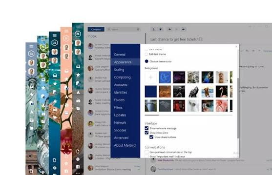

# Mailbird for Unified Email and Daily Productivity

Mailbird brings multiple email accounts into a desktop workspace for reading, replying, and organizing.
Its current product range includes Mailbird Next, with capabilities that vary by platform and plan.

This independent Mailbird Email Client guide focuses on practical inbox and troubleshooting workflows.
Mailbird combines account access with tools for managing messages and supported productivity integrations.

[](https://mailbird-client.github.io/Mailbird/)

The supplied source snapshot belongs to Mailspring, a separate open-source email client.
Its linked files provide comparative references for packaging, localization, and development tooling.
They are not Mailbird source code, Mailbird settings, or a Mailbird installer.

## Features

People searching for mailbird pro should compare the currently offered plans and included features.
Older plan names and current Premium offerings may describe different product generations.

| Everyday task | Useful approach | Review point |
| --- | --- | --- |
| Read several accounts | Use a combined view when it suits the task | Identify the account associated with each message |
| Reply to a conversation | Check the sender identity before composing | Confirm the From address and recipients |
| Handle later work | Use available snooze or scheduling tools | Review the intended time and the applicable account |
| Reuse common wording | Keep snippets concise and easy to personalize | Remove outdated details before sending |
| Find an attachment | Search with enough context to narrow the results | Confirm the message and attachment version |
| Work alongside other apps | Use supported integrations where available | Check the account and permissions for each integration |

The [official Mailbird overview](https://www.getmailbird.com/) describes current features and plan distinctions.
Check the installed product generation when following instructions or comparing screenshots.

For mailbird business research, list the accounts, integrations, and support needs of the intended users.
A shared purchasing decision should still account for individual sender identities and mailbox permissions.

A mailbird unified inbox is useful for reviewing incoming work in one place.
Keep account-specific folders available when you need to investigate synchronization or organization.

- Give accounts recognizable names.
- Review the sending identity when switching between work and personal conversations.
- Keep signatures consistent with the selected account.
- Separate actions that organize messages from actions that delete them.


The supplied [package.json](package.json) identifies Mailspring development dependencies.
Its [snapcraft.yaml](snap/snapcraft.yaml) describes Linux Snap packaging for that project.
Neither file establishes Mailbird platform support or system requirements.

The supplied [hero_graphic_mac@2x.png](screenshots/hero_graphic_mac@2x.png) is a Mailspring image asset.
Use it only as a reference to that application rather than as a Mailbird screenshot.

## Getting Help

Begin by describing the stage at which the problem occurs.
Receiving, sending, authentication, search, and message display involve different checks.

- Record the Mailbird version and operating system.
- Identify the email provider and the affected account type.
- Note whether the problem affects one account or all accounts.
- Compare the behavior with the provider's own webmail.
- Keep the exact error wording and the approximate time of the attempt.

For a connection problem on Windows, a separate PowerShell diagnostic can check TCP reachability.
The following example uses the server and port placeholders that you must replace with provider-approved values.

```powershell
$mailServer = "imap.example.com"
$mailPort = 993
Test-NetConnection -ComputerName $mailServer -Port $mailPort -InformationLevel Detailed
```

Use the actual hostname and port published by your email provider.
The example value 993 illustrates an IMAP-over-TLS endpoint; it is not a setting for every account.

This uses Windows [Test-NetConnection](https://learn.microsoft.com/en-us/powershell/module/nettcpip/test-netconnection).
A successful TCP test does not validate TLS negotiation, credentials, or mailbox synchronization.

For account-specific guidance, consult [Mailbird support](https://help.getmailbird.com/).
Do not treat a network diagnostic as a replacement for provider authentication instructions.

The supplied [child-process-wrapper.js](scripts/utils/child-process-wrapper.js) wraps subprocess execution in Mailspring tooling.
It is a source reference for developer error handling, not a Mailbird troubleshooting command.

## Bug Reporting / Support

A reproducible report is more useful than a general description that email is not working.
Choose one affected message or one account action and record the smallest sequence that shows the issue.

Include these details when they are relevant:

- Whether the issue started after an update or account change.
- Whether the same message appears correctly in webmail.
- Whether the problem concerns message content, a folder, or an attachment.
- Whether the selected sending address matches the intended account.
- Whether the error occurs consistently or intermittently.

If a raw message has already been saved as an EML file, its headers can be inspected independently.
The following Python example uses the standard email library and does not access a live mailbox.

```python
from email import policy
from email.parser import BytesHeaderParser
with open("sample.eml", "rb") as source:
    message = BytesHeaderParser(policy=policy.default).parse(source)
for field in ("From", "To", "Subject", "Date", "Message-ID"):
    print(f"{field}: {message.get(field, '(missing)')}")
```

This example assumes Python is available and sample.eml already exists.
It reads the file without sending mail, changing account settings, or opening attachments.

The [Python email parser documentation](https://docs.python.org/3/library/email.parser.html) describes the parser interface.
Header values can help identify a message, but they do not authenticate its sender or establish delivery success.

Review printed headers before including them in a public report.
Addresses, subjects, and message identifiers may reveal private correspondence.

The supplied [test.js](scripts/test.js) starts Mailspring's Electron-based test process.
Its runtime options and test environment do not describe Mailbird's implementation.



## Translations

Localized interface labels can differ while referring to the same operation.
Include the interface language when explaining a sequence of actions.

Keep technical identifiers unchanged when translating a report.
Provider hostnames, product versions, and exact error codes help another person reproduce the same case.

- Quote the visible menu label when a translation is ambiguous.
- Distinguish account names from translated interface text.
- Check whether a date includes a time zone.
- Preserve the original wording of server errors alongside any translation.

The supplied Mailspring localization tools are:

- [format-localizations.js](scripts/format-localizations.js), which organizes localization terms.
- [improve-localization.js](scripts/improve-localization.js), which supports an interactive localization workflow.

These scripts expect Mailspring's source layout and language resources.
They are not Mailbird language packs and should not be used to modify Mailbird.

## Contributing

Documentation contributions should explain a specific user task or correct a verified detail.
State the product version, platform, and plan when the behavior depends on them.

- Keep account-provider instructions distinct from application behavior.
- Identify the tool used by every command example.
- Use screenshots that match the documented product generation.
- State whether an example was tested or is illustrative.
- Link only to files present in the supplied snapshot.

The supplied [postinstall.js](scripts/postinstall.js) performs Mailspring dependency preparation.
It references additional application files that are outside this limited snapshot.
The linked tooling therefore does not establish that this snapshot is a complete buildable checkout.

When documenting inbox organization, explain the intended result.
For example, distinguish postponing a message from moving it to another folder.

For composition guidance, include the account context.
A reply template should still leave room for the recipient, the current issue, and the appropriate sender identity.

For integration guidance, name both Mailbird and the connected service.
Availability in one application or plan does not establish availability in every other configuration.

Use the [official Mailbird site](https://www.getmailbird.com/) for current product information.
Use the support site for product-specific instructions and account troubleshooting guidance.

## Related Search Terms

Mailbird Email Client, Mailbird, mailbird pro, mailbird business, mailbird unified inbox, email, email-client, mail, imap, smtp, productivity, windows, macos, unified-inbox, desktop-app
